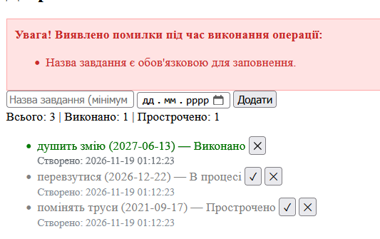
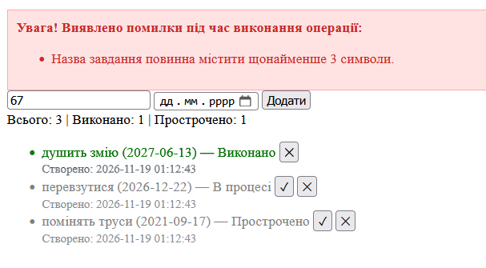
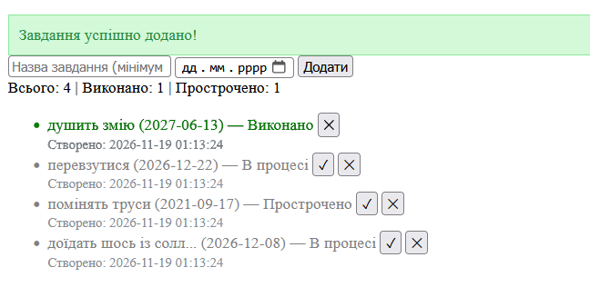
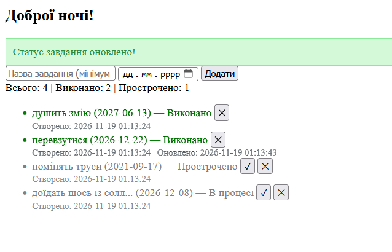
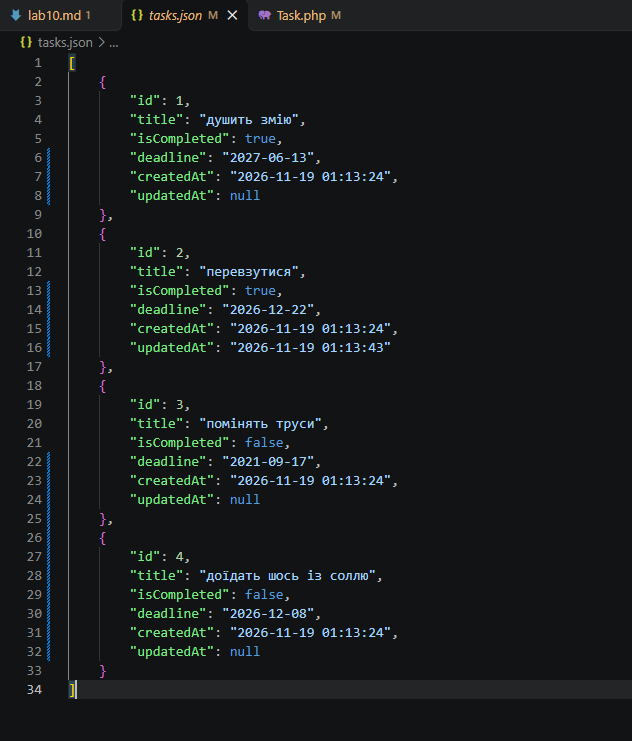

# Звіт до лабораторної роботи №11

## Тема

Застосування інтерфейсів, трейтів та обробки винятків у PHP. Рефакторинг проєкту «Менеджер завдань»: виділення контракту сховища `TaskStorageInterface`, інтеграція трейта `TimestampableTrait`, розробка ієрархії винятків (`TaskNotFoundException`, `ValidationException`) та обробка помилок за допомогою блоків `try...catch...finally`.

## Мета роботи

Закріпити поглиблені концепції ООП у PHP: проєктування інтерфейсів як абстрактних контрактів, горизонтальне перевикористання коду за допомогою трейтів, створення власних класів винятків та побудову взаємодії шару представлення з бізнес-логікою без аварійного завершення скриптів.

## Інтерфейс TaskStorageInterface

Інтерфейс описує контракт сховища завдань: отримання, пошук, додавання, зміну статусу, видалення та підрахунок. Усі методи мають типи параметрів і типи повернення, можливі винятки задокументовано тегом `@throws`, а в сигнатурах немає жодних деталей збереження (шляху до файлу, SQL-запитів тощо).

```php
<?php
declare(strict_types=1);

require_once __DIR__ . '/Task.php';

interface TaskStorageInterface
{
    /**
     * Повертає список усіх наявних завдань.
     *
     * @return Task[]
     */
    public function findAll(): array;

    /**
     * Знаходить завдання за його ідентифікатором.
     */
    public function findById(int $id): ?Task;

    /**
     * Додає нове завдання до сховища.
     *
     * @throws ValidationException якщо назва або дедлайн не проходять валідацію
     */
    public function add(string $title, ?string $deadline = null): Task;

    /**
     * Позначає завдання як виконане.
     *
     * @throws TaskNotFoundException якщо завдання з таким id не існує
     */
    public function complete(int $id): bool;

    /**
     * Видаляє завдання зі сховища.
     *
     * @throws TaskNotFoundException якщо завдання з таким id не існує
     */
    public function delete(int $id): bool;

    /**
     * Повертає кількість виконаних завдань.
     */
    public function countCompleted(): int;

    /**
     * Повертає кількість прострочених завдань.
     */
    public function countOverdue(): int;
}
```

## Трейт TimestampableTrait

Трейт містить поля дати створення та останнього оновлення об’єкта і методи для роботи з ними. Його можна підключити до будь-якого класу, якому потрібен аудит часу.

```php
<?php
declare(strict_types=1);

trait TimestampableTrait
{
    private string  $createdAt;
    private ?string $updatedAt = null;

    // Ініціалізує початкові значення дат створення та оновлення
    public function initTimestamps(?string $createdAt = null, ?string $updatedAt = null): void
    {
        $this->createdAt = $createdAt ?? date('Y-m-d H:i:s');
        $this->updatedAt = $updatedAt;
    }

    // Оновлює мітку часу останньої модифікації на поточний момент
    public function touch(): void { $this->updatedAt = date('Y-m-d H:i:s'); }

    public function getCreatedAt(): string { return $this->createdAt; }
    public function getUpdatedAt(): ?string { return $this->updatedAt; }
}
```

### Пояснення методів TimestampableTrait

- `initTimestamps()` задає дату створення (якщо вона не передана — поточний час) і дату оновлення.
- `touch()` записує поточний час як момент останньої модифікації.
- `getCreatedAt()` та `getUpdatedAt()` повертають відповідно дату створення та дату останнього оновлення (`null`, якщо об’єкт ще не змінювався).

## Ієрархія винятків (Exceptions.php)

```php
<?php
declare(strict_types=1);

// Базовий клас для всіх доменних помилок у системі управління завданнями
class TaskManagerException extends RuntimeException {}

// Виняток, що виникає при зверненні до завдання за неіснуючим ID
class TaskNotFoundException extends TaskManagerException
{
    public function __construct(int $taskId)
    {
        parent::__construct("Завдання з ідентифікатором #{$taskId} не знайдено.", 404);
    }
}

// Виняток валідації вхідних даних (може містити перелік із кількох помилок)
class ValidationException extends TaskManagerException
{
    /** @var string[] */
    private array $errors;

    public function __construct(array $errors)
    {
        $this->errors = $errors;
        parent::__construct('Помилка валідації даних форми: ' . implode(', ', $errors), 422);
    }

    /** @return string[] */
    public function getErrors(): array { return $this->errors; }
}
```

### Особливості ієрархії

- `TaskManagerException` успадковується від `RuntimeException` і є базовим класом для всіх доменних помилок менеджера завдань.
- `TaskNotFoundException` формує повідомлення з ідентифікатором неіснуючого завдання та передає код `404`.
- `ValidationException` зберігає масив помилок, тому користувач бачить усі зауваження до форми одночасно; метод `getErrors()` повертає цей масив, а батьківському класу передається код `422`.

## Оновлений клас Task

До класу підключено трейт `use TimestampableTrait;`. Конструктор отримав параметри `$createdAt` і `$updatedAt` та викликає `initTimestamps()`. Метод `complete()` тепер оновлює мітку часу через `touch()`, а `toArray()` і `fromArray()` серіалізують та відновлюють нові поля `createdAt` і `updatedAt`. Перевірку назви з конструктора прибрано, оскільки валідація тепер виконується в репозиторії з генерацією `ValidationException`.

```php
<?php
declare(strict_types=1);

require_once __DIR__ . '/TimestampableTrait.php';

class Task
{
    use TimestampableTrait;

    public function __construct(
        public readonly int    $id,
        private string         $title,
        private bool           $isCompleted = false,
        private ?string        $deadline    = null,
        ?string                $createdAt   = null,
        ?string                $updatedAt   = null,
    ) {
        $this->initTimestamps($createdAt, $updatedAt);
    }

    public function getId(): int { return $this->id; }
    public function getTitle(): string { return $this->title; }
    public function isCompleted(): bool { return $this->isCompleted; }
    public function getDeadline(): ?string { return $this->deadline; }

    public function isOverdue(): bool
    {
        if ($this->isCompleted || $this->deadline === null) {
            return false;
        }
        return strtotime($this->deadline) < time();
    }

    public function complete(): void
    {
        $this->isCompleted = true;
        $this->touch(); // Оновлюємо мітку часу модифікації
    }

    public function getStatusLabel(): string
    {
        if ($this->isCompleted) return 'Виконано';
        if ($this->isOverdue())  return 'Прострочено';
        return 'В процесі';
    }

    // Перетворює об'єкт на звичайний масив для JSON-кодування
    public function toArray(): array
    {
        return [
            'id'          => $this->id,
            'title'       => $this->title,
            'isCompleted' => $this->isCompleted,
            'deadline'    => $this->deadline,
            'createdAt'   => $this->getCreatedAt(),
            'updatedAt'   => $this->getUpdatedAt(),
        ];
    }

    // Статичний метод: з масиву (прочитаного з JSON) створює об'єкт Task
    public static function fromArray(array $data): self
    {
        return new self(
            id:          (int) $data['id'],
            title:       (string) $data['title'],
            isCompleted: (bool) ($data['isCompleted'] ?? false),
            deadline:    $data['deadline']  ?? null,
            createdAt:   $data['createdAt'] ?? null,
            updatedAt:   $data['updatedAt'] ?? null,
        );
    }
}
```

## Оновлений клас TaskRepository

Клас реалізує інтерфейс (`implements TaskStorageInterface`). Замість повернення `false` методи генерують доменні винятки. Нижче наведено змінені методи `add()`, `complete()` та `delete()`; решта методів (`findAll()`, `findById()`, `countCompleted()`, `countOverdue()`, `generateNextId()`, `load()`, `save()`) залишилися без змін з лабораторної роботи №10.

```php
<?php
declare(strict_types=1);

require_once __DIR__ . '/Task.php';
require_once __DIR__ . '/TaskStorageInterface.php';
require_once __DIR__ . '/Exceptions.php';

class TaskRepository implements TaskStorageInterface
{
    // ...

    public function add(string $title, ?string $deadline = null): Task
    {
        $errors = [];
        $cleanTitle = trim($title);

        if ($cleanTitle === '') {
            $errors[] = 'Назва завдання є обов\'язковою для заповнення.';
        } elseif (mb_strlen($cleanTitle) < 3) {
            $errors[] = 'Назва завдання повинна містити щонайменше 3 символи.';
        }

        if ($deadline !== null && $deadline !== '') {
            if (strtotime($deadline) === false) {
                $errors[] = 'Вказано некоректну дату дедлайну.';
            }
        } else {
            $deadline = null;
        }

        if (!empty($errors)) {
            throw new ValidationException($errors);
        }

        $task = new Task(
            id:          $this->generateNextId(),
            title:       $cleanTitle,
            isCompleted: false,
            deadline:    $deadline,
        );
        $this->tasks[] = $task;
        $this->save();
        return $task;
    }

    public function complete(int $id): bool
    {
        $task = $this->findById($id);
        if ($task === null) {
            throw new TaskNotFoundException($id);
        }
        $task->complete();
        $this->save();
        return true;
    }

    public function delete(int $id): bool
    {
        foreach ($this->tasks as $key => $task) {
            if ($task->getId() === $id) {
                unset($this->tasks[$key]);
                $this->tasks = array_values($this->tasks);
                $this->save();
                return true;
            }
        }
        throw new TaskNotFoundException($id);
    }

    // ...
}
```

### Пояснення змінених методів TaskRepository

- `add()` обрізає пробіли в назві та перевіряє, що вона не порожня і містить щонайменше 3 символи; якщо дедлайн передано, перевіряє, що `strtotime()` може його розпізнати. Усі знайдені помилки збираються в масив і передаються у `ValidationException`. Якщо помилок немає, створюється та зберігається нове завдання.
- `complete()` генерує `TaskNotFoundException`, якщо завдання з таким ID немає; інакше позначає його виконаним і зберігає зміни.
- `delete()` видаляє завдання і зберігає файл, а якщо збігів не знайдено — генерує `TaskNotFoundException`.

## Оновлення index.php

Блок обробки дій користувача обгорнуто в `try...catch...finally`. Блоки `catch` розташовано від найконкретнішого винятку до найзагальнішого: `ValidationException` → `TaskNotFoundException` → `TaskManagerException` → `Throwable`. Повідомлення про успішну дію зберігається в `$_SESSION['feedback']` і виводиться після перенаправлення, а помилки потрапляють у масив `$formErrors` та виводяться над формою. З поля назви прибрано атрибут `required`, щоб порожня форма доходила до сервера і перевірялася саме через `ValidationException`. Встановлення часового поясу перенесено на початок файлу, щоб мітки часу створення та оновлення записувалися за київським часом.

```php
<?php
declare(strict_types=1);
session_start();
date_default_timezone_set('Europe/Kiev');

require_once __DIR__ . '/Task.php';
require_once __DIR__ . '/TaskStorageInterface.php';
require_once __DIR__ . '/TaskRepository.php';
require_once __DIR__ . '/Exceptions.php';

if (!isset($_SESSION['is_logged_in']) || $_SESSION['is_logged_in'] !== true) {
    header('Location: login.php');
    exit;
}

// Залежність оголошена через інтерфейс
/** @var TaskStorageInterface $repo */
$repo = new TaskRepository(__DIR__ . '/tasks.json');

$formErrors = [];
$feedbackMessage = $_SESSION['feedback'] ?? null;
unset($_SESSION['feedback']);

if ($_SERVER['REQUEST_METHOD'] === 'POST') {
    $action = $_POST['action'] ?? '';

    try {
        if ($action === 'add') {
            $title    = $_POST['title'] ?? '';
            $deadline = trim($_POST['deadline'] ?? '') ?: null;

            $repo->add($title, $deadline);
            $_SESSION['feedback'] = 'Завдання успішно додано!';
            header('Location: index.php');
            exit;
        }

        if ($action === 'complete') {
            $repo->complete((int) ($_POST['id'] ?? 0));
            $_SESSION['feedback'] = 'Статус завдання оновлено!';
            header('Location: index.php');
            exit;
        }

        if ($action === 'delete') {
            $repo->delete((int) ($_POST['id'] ?? 0));
            $_SESSION['feedback'] = 'Завдання видалено!';
            header('Location: index.php');
            exit;
        }
    } catch (ValidationException $e) {
        // Перехоплюємо помилки валідації форми
        $formErrors = $e->getErrors();
    } catch (TaskNotFoundException $e) {
        // Перехоплюємо спробу маніпуляції неіснуючим завданням
        $formErrors = [$e->getMessage()];
    } catch (TaskManagerException $e) {
        // Загальний доменний виняток
        $formErrors = ['Помилка програми: ' . $e->getMessage()];
    } catch (Throwable $e) {
        // Непередбачена системна помилка
        $formErrors = ['Критичний збій обробки запиту. Зверніться до техпідтримки.'];
    } finally {
        // Код у finally виконується незалежно від наявності чи відсутності винятку
        // Наприклад, запис системного аудиту або закриття додаткових ресурсів
    }
}

$tasks = $repo->findAll();
```

Виведення повідомлень у шаблоні:

```php
        <?php if ($feedbackMessage): ?>
            <div class="alert-success"><?= htmlspecialchars($feedbackMessage) ?></div>
        <?php endif; ?>

        <?php if (!empty($formErrors)): ?>
            <div class="alert-error">
                <strong>Увага! Виявлено помилки під час виконання операції:</strong>
                <ul>
                    <?php foreach ($formErrors as $error): ?>
                        <li><?= htmlspecialchars($error) ?></li>
                    <?php endforeach; ?>
                </ul>
            </div>
        <?php endif; ?>
```

Виведення міток часу в картці завдання:

```php
                <div class="task-meta">
                    Створено: <?= htmlspecialchars($task->getCreatedAt()) ?>
                    <?php if ($task->getUpdatedAt()): ?>
                        | Оновлено: <?= htmlspecialchars($task->getUpdatedAt()) ?>
                    <?php endif; ?>
                </div>
```

## Фрагмент tasks.json

Після створення завдання та натискання кнопки виконання записи у `tasks.json` містять нові ключі `createdAt` та `updatedAt`:

```json
[
    {
        "id": 2,
        "title": "перевзутися",
        "isCompleted": true,
        "deadline": "2026-12-22",
        "createdAt": "2026-11-18 20:52:02",
        "updatedAt": "2026-11-18 20:52:03"
    }
]
```

Завдання, збережені до цієї лабораторної роботи, не мають цих ключів. Під час завантаження `fromArray()` отримує для них `null`, тому `initTimestamps()` підставляє поточний час, а у файл ключі записуються при наступному збереженні.

## Скріншоти

- Помилка валідації при відправленні порожньої форми: 
- Помилка валідації при назві з 1–2 символів: 
- Успішне створення завдання з міткою «Створено»: 
- Мітка «Оновлено» після натискання кнопки виконання: 
- Вміст tasks.json з полями `createdAt` та `updatedAt`: я

## Відповіді на контрольні запитання

1. **У чому полягає відмінність між `interface` та `abstract class`, і чому для сховища `TaskStorageInterface` обрано саме інтерфейс?**

   Абстрактний клас може містити властивості, конструктор і готові реалізації методів, але клас може успадкувати лише один абстрактний клас. Інтерфейс містить тільки сигнатури публічних методів без реалізації та стану, а один клас може реалізувати кілька інтерфейсів одночасно. Для сховища обрано інтерфейс, бо JSON-файл, сесія чи база даних не мають спільного коду збереження - у них спільний лише набір операцій. Інтерфейс фіксує саме цей набір і не прив’язує реалізацію до жодного батьківського класу.

2. **Як підключення репозиторію через контракт `TaskStorageInterface` полегшить перехід від JSON-файлів до бази даних MySQL за допомогою PDO?**

   `index.php` працює лише з методами, описаними в інтерфейсі, і не знає, як саме зберігаються дані. Для переходу на MySQL достатньо створити новий клас, наприклад `PdoTaskRepository implements TaskStorageInterface`, реалізувати в ньому ті самі методи через SQL-запити та замінити один рядок, у якому створюється об’єкт репозиторію. Обробка дій, перехоплення винятків і шаблон сторінки залишаться без змін.

3. **Яку проблему розв’язує `TimestampableTrait` в умовах відсутності множинного наслідування класів у PHP?**

   У PHP клас може мати лише одного батька, тому винести дати створення та оновлення в окремий батьківський клас означало б зайняти єдине місце в ієрархії спадкування. Трейт дозволяє «вставити» поля `createdAt`, `updatedAt` та методи `touch()`, `getCreatedAt()`, `getUpdatedAt()` у будь-який клас за допомогою `use`, не змінюючи його спадкування. Так одна й та сама логіка аудиту часу може використовуватися в різних класах без копіювання коду.

4. **Чому блок `catch (ValidationException $e)` обов’язково повинен розміщуватися перед `catch (TaskManagerException $e)` та `catch (Throwable $e)`?**

   PHP перевіряє блоки `catch` згори вниз і виконує перший, тип якого підходить до винятку. `ValidationException` є нащадком `TaskManagerException`, а той — нащадком `Throwable`, тому загальніший блок, розміщений вище, перехопив би й помилку валідації. Тоді код не дійшов би до виклику `getErrors()`, і користувач побачив би одне загальне повідомлення замість переліку конкретних помилок форми.

5. **За яких обставин виконується код всередині блоку `finally`, і які завдання з вивільнення системних ресурсів доцільно в ньому розташовувати?**

   Блок `finally` виконується завжди після `try` і `catch`: і коли виняток не виник, і коли його перехопив один із `catch`, і навіть коли виняток не перехоплено або в `try` виконано `return`. Тому в ньому розміщують дії, які мають відбутися за будь-якого результату: закриття файлів і з’єднань з базою даних, зняття блокувань файлів, запис системного аудиту чи логу про завершення операції.
