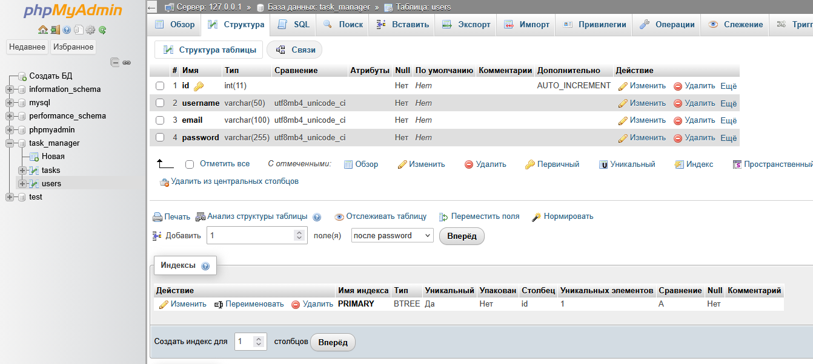
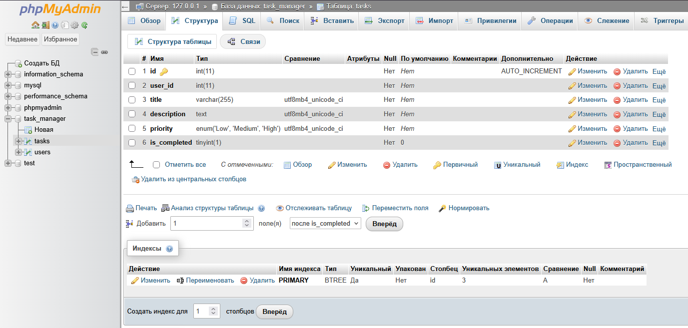
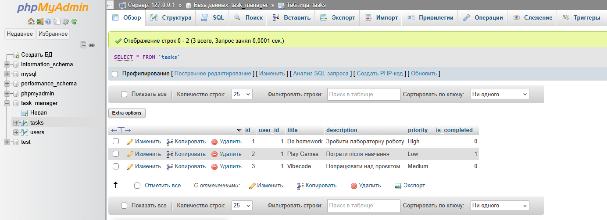
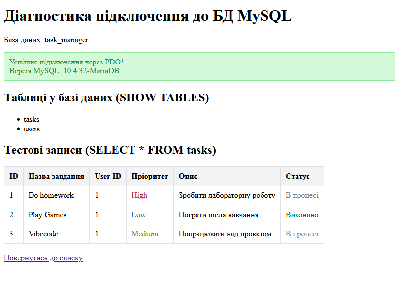
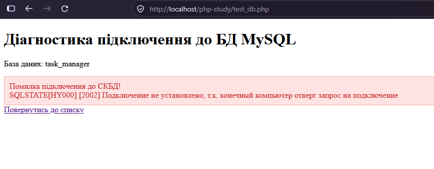

# Звіт до лабораторної роботи №12

## Тема

Налаштування СКБД MySQL, створення бази даних `task_manager` через phpMyAdmin та перевірка підключення до неї з PHP через PDO.

## Мета роботи

Навчитися створювати базу даних і таблиці в phpMyAdmin, працювати з первинними ключами, підключатися до MySQL через PDO, виконувати запити `SHOW TABLES` та `SELECT`, обробляти помилки підключення за допомогою `PDOException`.

## Структура таблиці users



## Структура таблиці tasks



## Тестові записи в таблиці tasks



## Файл database.sql

Структура бази даних та тестові записи містяться у файлі [database.sql](database.sql).

## Діагностичний скрипт test_db.php

```php
<?php
declare(strict_types=1);

$host = '127.0.0.1';
$port = '3306';
$dbname = 'task_manager';
$username = 'root';
$password = '';
$charset = 'utf8mb4';

$dsn = "mysql:host={$host};port={$port};dbname={$dbname};charset={$charset}";

$tables = [];
$tasks = [];
$connectionStatus = false;
$errorMessage = null;
$serverInfo = '';

$options = [
    PDO::ATTR_ERRMODE => PDO::ERRMODE_EXCEPTION,
    PDO::ATTR_DEFAULT_FETCH_MODE => PDO::FETCH_ASSOC,
    PDO::ATTR_EMULATE_PREPARES => false,
];

try {
    $pdo = new PDO($dsn, $username, $password, $options);
    $serverInfo = (string) $pdo->getAttribute(PDO::ATTR_SERVER_VERSION);

    $tablesStmt = $pdo->query('SHOW TABLES');
    $tables = $tablesStmt->fetchAll(PDO::FETCH_COLUMN);

    if (in_array('tasks', $tables, true)) {
        $tasksStmt = $pdo->query('SELECT * FROM tasks ORDER BY id ASC');
        $tasks = $tasksStmt->fetchAll();
    }

    $connectionStatus = true;
} catch (PDOException $e) {
    $connectionStatus = false;
    $errorMessage = $e->getMessage();
}
?>

<!DOCTYPE html>
<html lang="uk">
<head>
    <meta charset="UTF-8">
    <meta name="viewport" content="width=device-width, initial-scale=1.0">
    <title>Діагностика БД</title>
    <style>
        .alert-error {
            background: #ffe3e3;
            border: 1px solid #ffa8a8;
            color: #c92a2a;
            padding: 10px;
        }
        .alert-success {
            background: #d3f9d8;
            border: 1px solid #8ce99a;
            color: #2b8a3e;
            padding: 10px;
        }
        .task-done {
            color: green;
        }
        .task-pending {
            color: gray;
        }
        table {
            border-collapse: collapse;
            margin-bottom: 20px;
        }
        th, td {
            border: 1px solid #dee2e6;
            padding: 10px;
            text-align: left;
        }
        th {
            background: #f1f3f5;
        }
        .priority-high { color: #c92a2a; }
        .priority-medium { color: #a66b00; }
        .priority-low { color: #1971c2; }
    </style>
</head>
<body>
    <h1>Діагностика підключення до БД MySQL</h1>
    <p>База даних: <?= htmlspecialchars($dbname) ?></p>

    <?php if ($connectionStatus): ?>
        <div class="alert-success">
            Успішне підключення через PDO!
            <br>Версія MySQL: <?= htmlspecialchars($serverInfo) ?>
        </div>

        <h2>Таблиці у базі даних (SHOW TABLES)</h2>
        <?php if (!empty($tables)): ?>
            <ul>
                <?php foreach ($tables as $table): ?>
                    <li><?= htmlspecialchars($table) ?></li>
                <?php endforeach; ?>
            </ul>
        <?php else: ?>
            <p>У базі даних немає таблиць.</p>
        <?php endif; ?>

        <h2>Тестові записи (SELECT * FROM tasks)</h2>
        <?php if (!empty($tasks)): ?>
            <table>
                <thead>
                    <tr>
                        <th>ID</th>
                        <th>Назва завдання</th>
                        <th>User ID</th>
                        <th>Пріоритет</th>
                        <th>Опис</th>
                        <th>Статус</th>
                    </tr>
                </thead>
                <tbody>
                    <?php foreach ($tasks as $task): ?>
                        <?php
                        $priorityClass = match ($task['priority']) {
                            'High' => 'priority-high',
                            'Low' => 'priority-low',
                            default => 'priority-medium',
                        };
                        ?>
                        <tr>
                            <td><?= (int) $task['id'] ?></td>
                            <td><?= htmlspecialchars($task['title']) ?></td>
                            <td><?= (int) $task['user_id'] ?></td>
                            <td class="<?= $priorityClass ?>"><?= htmlspecialchars($task['priority']) ?></td>
                            <td><?= htmlspecialchars($task['description']) ?></td>
                            <td class="<?= $task['is_completed'] ? 'task-done' : 'task-pending' ?>">
                                <?= $task['is_completed'] ? 'Виконано' : 'В процесі' ?>
                            </td>
                        </tr>
                    <?php endforeach; ?>
                </tbody>
            </table>
        <?php else: ?>
            <p>У таблиці tasks немає записів або таблиця ще не створена.</p>
        <?php endif; ?>
    <?php else: ?>
        <div class="alert-error">
            Помилка підключення до СКБД!
            <br><?= htmlspecialchars($errorMessage ?? 'Невідома помилка') ?>
        </div>
    <?php endif; ?>

    <a href="index.php">Повернутись до списку</a>
</body>
</html>
```

## Оновлення index.php

Для переходу на сторінку діагностики додано посилання. Основний менеджер завдань поки що працює з файлом `tasks.json`.

```php
<a href="test_db.php">Діагностика БД (MySQL)</a>
```

## Скриншот успішного підключення



## Скриншот помилки при вимкненому MySQL



## Відповіді на контрольні запитання

1. **Що таке СКБД (DBMS)? У чому полягає різниця між MySQL та phpMyAdmin?**

    СКБД — це система керування базами даних, яка дозволяє створювати таблиці, зберігати, читати та змінювати дані. MySQL є самим сервером баз даних, який виконує SQL-запити, а phpMyAdmin — веб-інтерфейс для зручної роботи з цим сервером через браузер.

2. **Для чого використовується атрибут Auto Increment (A_I), який призначається первинному полю id?**

    `AUTO_INCREMENT` автоматично генерує наступне числове значення для поля `id` при додаванні нового запису. Тому не потрібно кожного разу вручну вказувати ID чи шукати наступне вільне число.

3. **Що таке PRIMARY KEY і для чого він потрібен у реляційній таблиці?**

    Первинний ключ — це поле або набір полів, за якими можна однозначно визначити конкретний запис у таблиці. Його значення не можуть повторюватися чи бути `NULL`. У нашому випадку первинним ключем є поле `id`.

4. **У чому різниця між текстовими типами VARCHAR та TEXT у MySQL?**

    `VARCHAR` зберігає рядки змінної довжини з указаним обмеженням, наприклад `VARCHAR(50)` для логіна. `TEXT` використовується для довших текстів, наприклад опису завдання, і не потребує вказання довжини при створенні поля.

5. **Чому для збереження паролів виділено стовпець VARCHAR(255)?**

    У базі даних потрібно зберігати не сам пароль, а його хеш, отриманий, наприклад, через `password_hash()`. Довжина хешу залежить від алгоритму, тому 255 символів залишають достатньо місця для різних алгоритмів хешування.

6. **Що таке PDO (PHP Data Objects) та які його переваги порівняно з mysql_*?**

    PDO — це об’єктно-орієнтований інтерфейс PHP для роботи з базами даних. Він підтримує різні СКБД, підготовлені запити, які допомагають захиститися від SQL-ін’єкцій, та обробку помилок через винятки. Старі функції `mysql_*` працювали лише з MySQL і були видалені з PHP 7.

7. **Що таке DSN (Data Source Name) та з яких компонентів він складається при підключенні до MySQL?**

    DSN — це рядок, який передає PDO параметри підключення до бази даних. У нашому випадку він містить назву драйвера `mysql`, адресу сервера `host`, порт `port`, назву бази даних `dbname` та кодування `charset`. Логін і пароль передаються окремо при створенні об’єкта PDO.

8. **Чому підключення до бази даних через PDO необхідно огортати в блок try...catch (PDOException)?**

    Якщо сервер MySQL вимкнений, база даних не існує або параметри підключення неправильні, PDO може згенерувати виняток. Блок `catch` перехоплює `PDOException`, тому замість аварійного завершення скрипту користувач побачить повідомлення про помилку. Через `getMessage()` можна дізнатися її причину.
