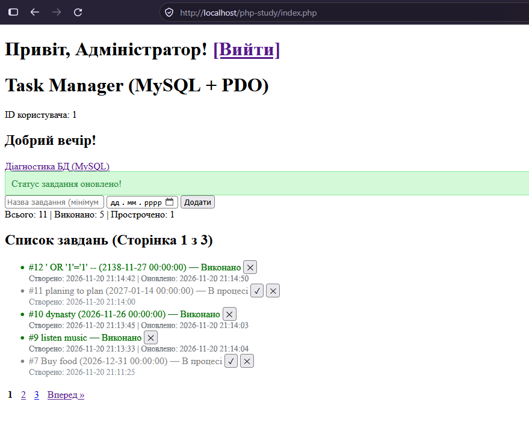
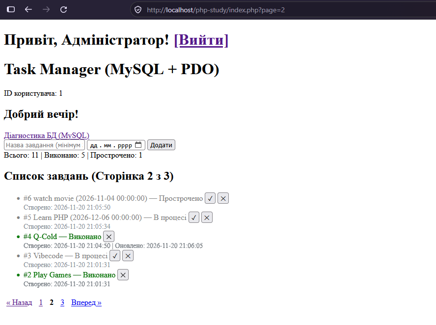
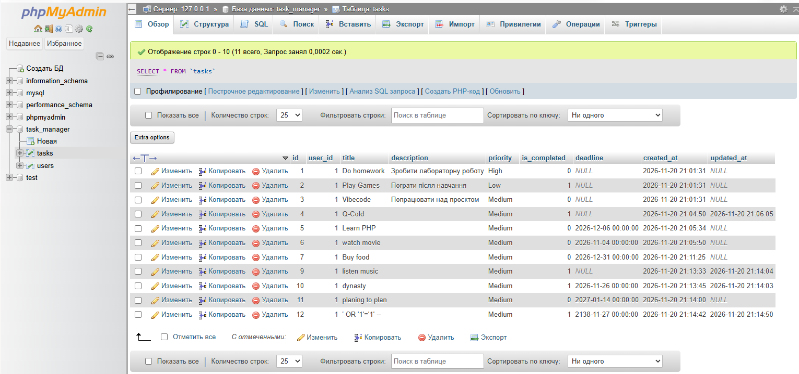

# Звіт до лабораторної роботи №13

## Тема

Реалізація патерну Repository та CRUD-операцій у PHP через PDO. Перехід з JSON-сховища на MySQL, підготовлені запити та пагінація завдань.

## Мета роботи

Навчитися працювати з MySQL через PDO, виконувати операції створення, читання, оновлення та видалення записів, використовувати підготовлені запити, фільтрацію за користувачем і постраничну навігацію.

## Оновлення бази даних

До таблиці `tasks` з лабораторної роботи №12 додаються поля `deadline`, `created_at`, `updated_at`, індекс і зовнішній ключ для `user_id`. Поля `description` та `priority` залишаються без змін.

```sql
USE `task_manager`;

ALTER TABLE `tasks`
    ADD COLUMN `deadline` DATETIME NULL,
    ADD COLUMN `created_at` DATETIME NOT NULL DEFAULT CURRENT_TIMESTAMP,
    ADD COLUMN `updated_at` DATETIME NULL ON UPDATE CURRENT_TIMESTAMP,
    ADD INDEX `idx_tasks_user_id` (`user_id`),
    ADD CONSTRAINT `fk_tasks_user` FOREIGN KEY (`user_id`) REFERENCES `users` (`id`);
```

## Реалізація Database.php

Клас `Database` створює один об'єкт PDO та повертає його через статичний метод `getConnection()`. Для обробки помилок увімкнено винятки, а емуляцію підготовлених запитів вимкнено.

```php
<?php
declare(strict_types=1);

class Database
{
    private static ?PDO $connection = null;

    public static function getConnection(): PDO
    {
        if (self::$connection === null) {
            $dsn = 'mysql:host=127.0.0.1;port=3306;dbname=task_manager;charset=utf8mb4';
            $options = [
                PDO::ATTR_ERRMODE => PDO::ERRMODE_EXCEPTION,
                PDO::ATTR_DEFAULT_FETCH_MODE => PDO::FETCH_ASSOC,
                PDO::ATTR_EMULATE_PREPARES => false,
            ];

            try {
                self::$connection = new PDO($dsn, 'root', '', $options);
            } catch (PDOException $e) {
                throw new RuntimeException('Помилка підключення до бази даних.', 0, $e);
            }
        }

        return self::$connection;
    }
}
```

## Оновлення Task та TaskStorageInterface

До класу `Task` додано властивість `userId`. Методи `fromArray()` та `toArray()` працюють з назвами полів таблиці (`user_id`, `is_completed`, `created_at`, `updated_at`). У контракті репозиторію додано фільтрацію за користувачем, підрахунок записів та параметри пагінації.

## Фрагменти коду TaskRepository.php

Репозиторій приймає об'єкт PDO через конструктор. Усі запити виконуються через `prepare()` та `execute()`, а пошук, оновлення і видалення записів обмежуються ідентифікатором користувача.

### Метод `findAllByUser()`

```php
    public function findAllByUser(int $userId, int $page = 1, int $perPage = 5): array
    {
        $offset = ($page - 1) * $perPage;
        $stmt = $this->pdo->prepare('SELECT * FROM tasks WHERE user_id = :user_id ORDER BY id DESC LIMIT :limit OFFSET :offset');
        $stmt->bindValue(':user_id', $userId, PDO::PARAM_INT);
        $stmt->bindValue(':limit', $perPage, PDO::PARAM_INT);
        $stmt->bindValue(':offset', $offset, PDO::PARAM_INT);
        $stmt->execute();

        return array_map(fn(array $row) => Task::fromArray($row), $stmt->fetchAll());
    }
```

### Метод `add()`

```php
    public function add(int $userId, string $title, ?string $deadline = null): Task
    {
        $errors = [];
        $title = trim($title);
        if ($title === '') {
            $errors[] = 'Назва завдання є обов\'язковою для заповнення.';
        } elseif (mb_strlen($title) < 3) {
            $errors[] = 'Назва завдання повинна містити щонайменше 3 символи.';
        } elseif (mb_strlen($title) > 255) {
            $errors[] = 'Назва завдання не може містити більше 255 символів.';
        }

        $deadline = $deadline !== null ? trim($deadline) : '';
        if ($deadline !== '') {
            $date = DateTimeImmutable::createFromFormat('!Y-m-d', $deadline);
            if (!$date || $date->format('Y-m-d') !== $deadline) {
                $errors[] = 'Вказано некоректну дату дедлайну.';
            }
        } else {
            $deadline = null;
        }

        if ($errors) {
            throw new ValidationException($errors);
        }

        $stmt = $this->pdo->prepare('INSERT INTO tasks (user_id, title, description, priority, is_completed, deadline, created_at) VALUES (:user_id, :title, :description, :priority, 0, :deadline, NOW())');
        $stmt->execute([
            'user_id' => $userId,
            'title' => $title,
            'description' => '',
            'priority' => 'Medium',
            'deadline' => $deadline,
        ]);

        $id = (int) $this->pdo->lastInsertId();
        $task = $this->findByIdAndUser($id, $userId);
        if ($task === null) {
            throw new RuntimeException('Не вдалося отримати створене завдання.');
        }
        return $task;
    }
```

### Метод `complete()`

```php
    public function complete(int $id, int $userId): bool
    {
        $stmt = $this->pdo->prepare('UPDATE tasks SET is_completed = 1, updated_at = NOW() WHERE id = :id AND user_id = :user_id');
        $stmt->execute(['id' => $id, 'user_id' => $userId]);

        if ($stmt->rowCount() === 0 && $this->findByIdAndUser($id, $userId) === null) {
            throw new TaskNotFoundException($id);
        }
        return true;
    }
```

### Метод `delete()`

```php
    public function delete(int $id, int $userId): bool
    {
        $stmt = $this->pdo->prepare('DELETE FROM tasks WHERE id = :id AND user_id = :user_id');
        $stmt->execute(['id' => $id, 'user_id' => $userId]);

        if ($stmt->rowCount() === 0) {
            throw new TaskNotFoundException($id);
        }
        return true;
    }
```

У методі `add()` поля `description` і `priority`, які залишилися з ЛР №12, отримують порожній рядок та значення `Medium` відповідно. `lastInsertId()` повертає ID щойно доданого завдання. `complete()` та `delete()` перевіряють, чи належить завдання поточному користувачу.

## Оновлення index.php

Замість JSON-сховища використовується репозиторій MySQL. Ідентифікатор авторизованого користувача зберігається у сесії під час входу. Для пагінації встановлено 5 завдань на сторінку, а загальна кількість сторінок розраховується на основі кількості записів користувача.

```php
$currentUserId = (int) $_SESSION['user_id'];
$repo = new TaskRepository(Database::getConnection());
```

```php
$perPage = 5;
$page = max(1, (int) ($_GET['page'] ?? 1));
$totalTasks = $repo->countByUser($currentUserId);
$totalPages = max(1, (int) ceil($totalTasks / $perPage));
$page = min($page, $totalPages);
$tasks = $repo->findAllByUser($currentUserId, $page, $perPage);
```

## Скриншот першої сторінки



## Скриншот другої сторінки



## Скриншот таблиці tasks у phpMyAdmin



## Відповіді на контрольні запитання

1. __Що таке PDO у PHP та в чому його переваги порівняно з mysql_* і процедурним mysqli?__

PDO — це об'єктно-орієнтований інтерфейс PHP для роботи з базами даних. Він має єдиний інтерфейс для різних СКБД, підтримує підготовлені запити та обробку помилок через винятки. Функції `mysql_*` застаріли й були видалені з PHP 7. `mysqli` теж підтримує підготовлені запити, але працює лише з MySQL, тоді як PDO підтримує різні драйвери.

2. __Як підготовлені запити захищають від SQL-ін'єкцій та чому небезпечна конкатенація змінних у SQL?__

Підготовлені запити відокремлюють SQL-команду від значень, що вводить користувач. Спочатку через `prepare()` задається структура запиту з параметрами, а потім через `execute()` передаються дані. Вони обробляються як значення, а не як частина SQL-команди. При звичайній конкатенації введений текст може змінити структуру запиту.

3. __Чому LIMIT та OFFSET передаються через bindValue() з типом PDO::PARAM_INT?__

`LIMIT` та `OFFSET` очікують цілі числа. При передачі масиву в `execute()` PDO за замовчуванням використовує тип рядка для параметрів. Через `bindValue()` з `PDO::PARAM_INT` явно вказується числовий тип, щоб параметри коректно передавалися без емуляції підготовлених запитів.

4. __Для чого використовується PDO::lastInsertId()?__

Метод повертає ідентифікатор останнього доданого запису у поточному з'єднанні з базою даних. Його викликають після успішного `INSERT`, до наступних операцій, які можуть змінити це значення. PDO повертає ID у вигляді рядка (або `false` у разі невдачі), тому в репозиторії він приводиться до типу `int`.

5. __Як працює пагінація та формула offset = (page - 1) * perPage?__

`LIMIT` визначає максимальну кількість записів, а `OFFSET` — скільки записів потрібно пропустити. Для першої сторінки при 5 записах на сторінку зміщення дорівнює 0, для другої — 5, для третьої — 10. Загальна кількість записів отримується через `COUNT(*)`, а кількість сторінок розраховується округленням результату ділення в більшу сторону.
