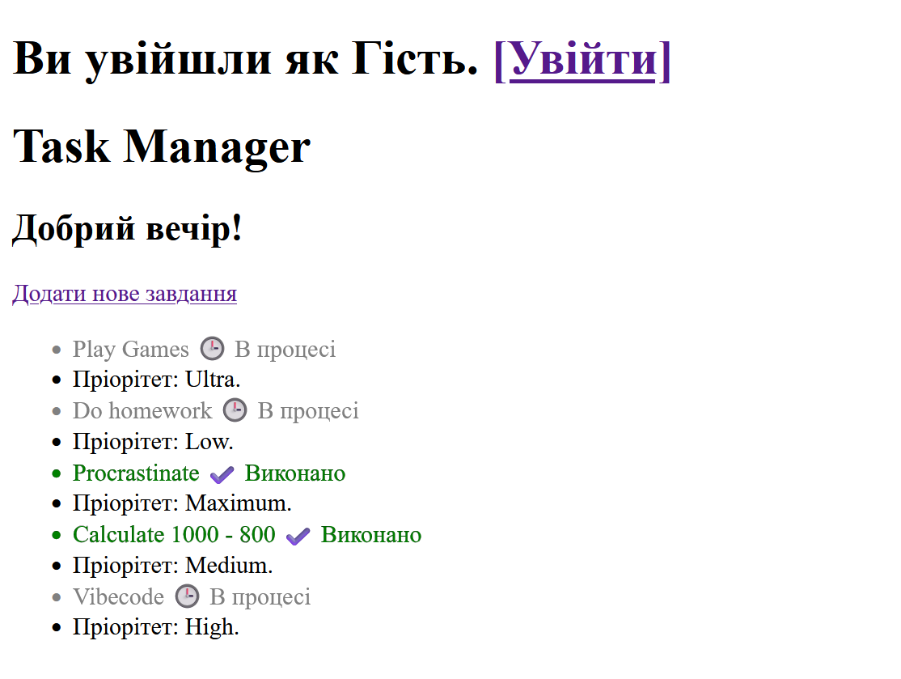
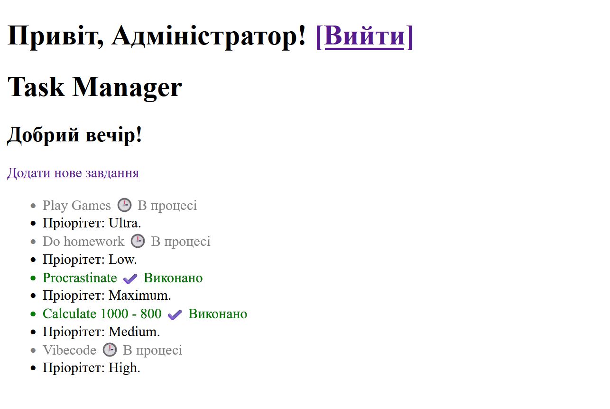

# Звіт до Лабораторної роботи №10

## Фрагмент коду авторизації

```php

<?php
session_start();
if ($_SERVER['REQUEST_METHOD'] === 'POST') {
    if ($_POST['username'] === 'admin' && $_POST['password'] === '12345') {
        $_SESSION['is_logged_in'] = true;
        $_SESSION['user_name'] = 'Адміністратор';
        header('Location: index.php');
        exit;
    } else {
        $error = "Невірний логін або пароль!";
    }
}
?>

<!DOCTYPE html>
<html lang="uk">
<head>
    <meta charset="UTF-8">
    <meta name="viewport" content="width=device-width, initial-scale=1.0">
    <title>Вхід</title>
</head>
<body>

    <h2>Авторизація</h2>
    <form action="" method="POST">
        <div>
            <label for="username">Ім'я користувача:</label>
            <input type="text" name="username" id="username" required>
        </div>
        <br>
        <div>
            <label for="password">Пароль:</label>
            <input type="password" name="password" id="password" required>
        </div>
        <br>
        <input type="submit" value="Увійти">
    </form>

</body>
</html>

```

## Фрагмент коду перенаправлення

```php

   <?php
   session_start();
   if (!isset($_SESSION['is_logged_in']) || $_SESSION['is_logged_in'] !== true) {
       header('Location: login.php');
       exit;
   }
   ?>

```

## Скриншот гостя



## Скриншот адміна



## Відповіді на питання:

1. __HTTP — це “stateless” протокол (без стану). Що це означає для розробника і чому сервер не впізнає одного й того ж користувача на різних сторінках без додаткових інструментів?__

Це означає, що сервер нічого не запам'ятовує про клієнта після того, як віддав йому сторінку. Кожен новий запит він сприймає як від абсолютно нового користувача. Тому розробнику доводиться додатково використовувати сесії та кукі, щоб система могла впізнавати людей при переході між сторінками.

2. __Яка різниця між Cookie та Сесією (`$_SESSION`)? Де фізично зберігаються дані змінних сесії (на клієнті в браузері чи на сервері)?__

Кукі зберігаються прямо в браузері користувача, тому їх можна випадково видалити або навіть підмінити. А змінні сесії фізично лежать на самому сервері, що набагато безпечніше і надійніше.

3. __Що таке `PHPSESSID` і яку функцію виконує цей файл cookie?__

Це спеціальний файл кукі з унікальним ідентифікатором користувача. Коли браузер робить запит, сервер бачить цей PHPSESSID і одразу розуміє, чию саме папку з даними сесії йому потрібно відкрити.

4. __Для чого необхідно викликати `session_start()` на самому-самому початку файлу, навіть до тегу `<html>` чи пробілів? Яку помилку ви отримаєте, якщо викличете це після HTML-коду (Headers already sent)?__

Ця функція відправляє браузеру невидимі заголовки, щоб встановити зв'язок. За правилами інтернету всі такі заголовки мають йти суворо до будь-якого виводу коду на екран, навіть до звичайного пробілу. Якщо вивести HTML, а потім викликати старт сесії, вилізе відома помилка Cannot modify header information.

5. __Що виконує функція `header('Location: ...')` і чому після перенаправлення обов’язково треба писати `exit` (або `die`)?__

Вона наказує браузеру перенаправити користувача на іншу сторінку. Функція exit після неї пишеться для того, щоб скрипт миттєво зупинив свою роботу. Інакше людину перекине на іншу сторінку, але код нижче все одно відпрацює у фоновому режимі на сервері, що часто призводить до багів.
