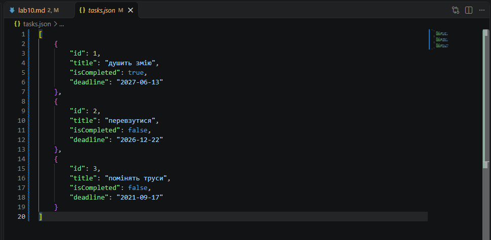
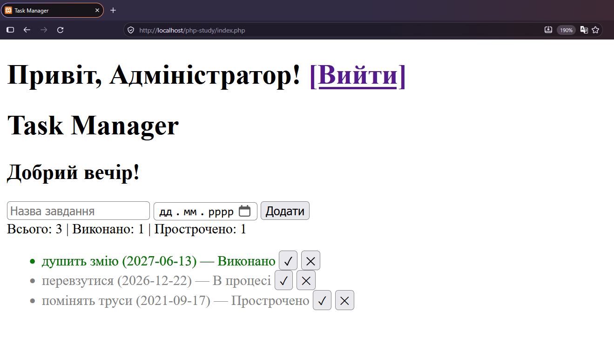

# Звіт до лабораторної роботи №10

## Тема

Вступ до ООП у PHP. Перетворення менеджера завдань з асоціативних масивів на об’єкти класу `Task` та керування ними через `TaskRepository`.

## Мета роботи

Ознайомитися з класами, об’єктами, властивостями, методами, модифікаторами доступу та конструктором у PHP. Переписати менеджер завдань на об’єктно-орієнтований стиль і зберігати завдання у JSON-файлі.

## Реалізація класу Task

Клас `Task` описує одне завдання. Ідентифікатор є незмінним (`readonly`), а назву, стан виконання та дедлайн можна прочитати через геттери. Конструктор відхиляє порожню назву.

```php
<?php
declare(strict_types=1);

class Task
{
    public function __construct(
        public readonly int    $id,
        private string         $title,
        private bool           $isCompleted = false,
        private ?string        $deadline    = null,
    ) {
        if (empty(trim($title))) {
            throw new InvalidArgumentException('Назва завдання не може бути порожньою.');
        }
    }

    public function getTitle(): string { return $this->title; }
    public function isCompleted(): bool { return $this->isCompleted; }
    public function getDeadline(): ?string { return $this->deadline; }

    public function isOverdue(): bool
    {
        if ($this->isCompleted || $this->deadline === null) {
            return false;
        }
        return strtotime($this->deadline) < time();
    }

    public function complete(): void { $this->isCompleted = true; }

    public function getStatusLabel(): string
    {
        if ($this->isCompleted) return 'Виконано';
        if ($this->isOverdue())  return 'Прострочено';
        return 'В процесі';
    }

    // Перетворює об'єкт на звичайний масив для JSON-кодування
    public function toArray(): array
    {
        return [
            'id'          => $this->id,
            'title'       => $this->title,
            'isCompleted' => $this->isCompleted,
            'deadline'    => $this->deadline,
        ];
    }

    // Статичний метод: з масиву (прочитаного з JSON) створює об'єкт Task
    public static function fromArray(array $data): self
    {
        return new self(
            id:          $data['id'],
            title:       $data['title'],
            isCompleted: $data['isCompleted'] ?? false,
            deadline:    $data['deadline']    ?? null,
        );
    }

    public function getId(): int { return $this->id; }
}
```

### Пояснення методів Task

- `__construct()` задає значення властивостей через Constructor Promotion і перевіряє, що назва після обрізання пробілів не порожня.
- `getTitle()`, `isCompleted()`, `getDeadline()` та `getId()` повертають відповідно назву, стан виконання, дедлайн та незмінний ідентифікатор завдання.
- `isOverdue()` повертає `true`, якщо завдання ще не виконане, має дедлайн і його дата вже минула.
- `complete()` позначає завдання виконаним.
- `getStatusLabel()` повертає текстовий статус: «Виконано», «Прострочено» або «В процесі».
- `toArray()` представляє властивості об’єкта у вигляді асоціативного масиву, придатного для JSON-кодування.
- `fromArray()` є статичним фабричним методом: створює `Task` з масиву, а для відсутніх полів стану та дедлайну використовує значення за замовчуванням.

## Реалізація класу TaskRepository

Репозиторій зберігає колекцію об’єктів `Task`, завантажує її з JSON-файлу та записує зміни назад у файл.

```php
<?php
declare(strict_types=1);

require_once __DIR__ . '/Task.php';

class TaskRepository
{
    /** @var Task[] */
    private array $tasks = [];

    public function __construct(private string $storageFile)
    {
        $this->load();
    }

    public function findAll(): array  { return $this->tasks; }

    public function findById(int $id): ?Task
    {
        foreach ($this->tasks as $task) {
            if ($task->getId() === $id) return $task;
        }
        return null;
    }

    public function add(string $title, ?string $deadline = null): Task
    {
        $task = new Task($this->generateNextId(), $title, false, $deadline);
        $this->tasks[] = $task;
        $this->save();
        return $task;
    }

    public function complete(int $id): bool
    {
        $task = $this->findById($id);
        if (!$task) return false;
        $task->complete();
        $this->save();
        return true;
    }

    public function delete(int $id): bool
    {
        foreach ($this->tasks as $key => $task) {
            if ($task->getId() === $id) {
                unset($this->tasks[$key]);
                $this->tasks = array_values($this->tasks);
                $this->save();
                return true;
            }
        }
        return false;
    }

    public function countCompleted(): int
    {
        return count(array_filter($this->tasks, fn(Task $t) => $t->isCompleted()));
    }

    public function countOverdue(): int
    {
        return count(array_filter($this->tasks, fn(Task $t) => $t->isOverdue()));
    }

    private function generateNextId(): int
    {
        if (empty($this->tasks)) return 1;
        return max(array_map(fn(Task $t) => $t->getId(), $this->tasks)) + 1;
    }

    private function load(): void
    {
        if (!file_exists($this->storageFile)) { $this->tasks = []; return; }
        $data = json_decode(file_get_contents($this->storageFile), true) ?? [];
        $this->tasks = array_map(fn(array $item) => Task::fromArray($item), $data);
    }

    private function save(): void
    {
        $data = array_map(fn(Task $t) => $t->toArray(), $this->tasks);
        file_put_contents(
            $this->storageFile,
            json_encode($data, JSON_PRETTY_PRINT | JSON_UNESCAPED_UNICODE)
        );
    }
}
```

### Пояснення методів TaskRepository

- `__construct()` приймає шлях до файлу сховища та одразу завантажує з нього завдання.
- `findAll()` повертає всю колекцію завдань.
- `findById()` шукає завдання за ідентифікатором і повертає `null`, якщо його немає.
- `add()` створює завдання з наступним вільним ідентифікатором, додає до колекції, зберігає файл і повертає створений об’єкт.
- `complete()` знаходить завдання, позначає його виконаним і зберігає зміни; повертає `false`, якщо такого завдання немає.
- `delete()` вилучає завдання за ідентифікатором, переіндексовує масив і зберігає результат; якщо збігів немає, повертає `false`.
- `countCompleted()` рахує виконані завдання.
- `countOverdue()` рахує невиконані завдання з минулим дедлайном.
- `generateNextId()` повертає `1` для порожньої колекції або найбільший наявний ID плюс один.
- `load()` читає JSON і перетворює кожен елемент на об’єкт `Task`; якщо файла ще немає, створює порожню колекцію в пам’яті.
- `save()` перетворює об’єкти на масиви та записує їх у JSON із відступами й незміненою кирилицею.

## Оновлення index.php

У `index.php` підключено класи `Task` і `TaskRepository`. Сторінка перевіряє авторизацію, створює репозиторій для `tasks.json` і обробляє дії додавання, виконання та видалення завдань через його методи. Після POST-запиту виконується перенаправлення назад на `index.php`.

Для відображення список отримується через `$repo->findAll()`. Шаблон читає дані методами об’єкта, показує дедлайн і статус, а також виводить загальну кількість, виконані та прострочені завдання. Назви завдань екрануються через `htmlspecialchars()`.

## Приклад даних у tasks.json

Файл `tasks.json` є постійним JSON-сховищем. Після додавання завдань він має містити записи такого формату:

```json
[
    {
        "id": 1,
        "title": "Підготувати звіт",
        "isCompleted": false,
        "deadline": "2026-11-20"
    }
]
```

Поточний файл сховища на момент підготовки звіту порожній (`[]`), тому приклад вище демонструє формат запису, а не фактичні дані користувача.

## Скріншоти

Скріншоти потрібно додати після перевірки програми з трьома завданнями та різними статусами:

- JSON-файл після додавання завдань: 
- Сторінка менеджера завдань: 

## Відповіді на контрольні запитання

1. **Що таке клас і чим він відрізняється від масиву? Чому завдання зручніше представити об’єктом?**

   Клас є описом структури та поведінки об’єктів, а об’єкт — конкретним екземпляром цього класу. Масив лише зберігає набір значень, тоді як `Task` об’єднує дані завдання з методами для перевірки дедлайну, зміни стану та формування статусу. Це зменшує ризик помилитися в назвах ключів і тримає логіку роботи із завданням поруч із його даними.

2. **Що таке `private`-властивість і як зовнішній код може прочитати `$title`?**

   `private` обмежує доступ до властивості межами класу `Task`. Зовнішній код читає назву через публічний метод `getTitle()`, а змінити її напряму не може.

3. **Що означає `public readonly int $id` і чому стан виконання не `readonly`?**

   Constructor Promotion оголошує властивість `$id` типу `int` і присвоює їй передане значення під час створення об’єкта. `readonly` дозволяє задати ID лише один раз, бо ідентифікатор не повинен змінюватися. `$isCompleted` змінюється методом `complete()`, тому ця властивість не є `readonly`.

4. **Що робить `Task::fromArray($data)` і навіщо метод статичний?**

   Метод створює новий об’єкт `Task` із даних асоціативного масиву, наприклад після читання JSON. Він статичний, бо для створення об’єкта не потрібен уже наявний екземпляр `Task`; виклик відбувається безпосередньо через клас.

5. **Як дані проходять від `$repo->add()` до файлу `tasks.json`?**

   Метод `add()` генерує ID, створює об’єкт `Task` і додає його до внутрішньої колекції. Далі `save()` викликає `toArray()` для кожного завдання, кодує отримані масиви функцією `json_encode()` і записує JSON у файл за допомогою `file_put_contents()`. Під час наступного запиту конструктор репозиторію викликає `load()`, який декодує JSON та відновлює об’єкти через `Task::fromArray()`.