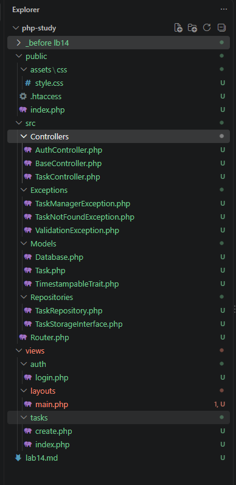
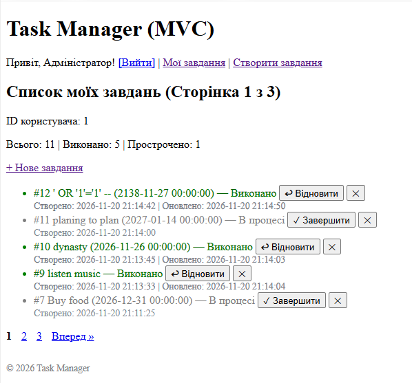
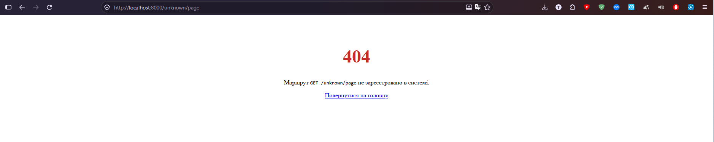

# Звіт до лабораторної роботи №14

## Тема

Архітектурний рефакторинг застосунку на патерн MVC та маршрутизація. Перехід до структури Model-View-Controller з єдиною точкою входу.

## Мета роботи

Навчитися розділяти логіку застосунку на моделі, представлення та контролери, створювати маршрутизатор і використовувати буферизацію виводу для підключення шаблонів.

## Реалізація Router.php

Клас `Router` зберігає маршрути для методів GET та POST. Метод `dispatch()` отримує шлях запиту, знаходить відповідний контролер та викликає його метод. Якщо маршруту немає, повертається HTTP-код 404.

```php
    public function dispatch(string $method, string $uri): void
    {
        $path = parse_url($uri, PHP_URL_PATH) ?: '/';
        $path = rtrim($path, '/') ?: '/';
        $method = strtoupper($method);

        if (!isset($this->routes[$method][$path])) {
            $this->handleNotFound($method, $path);
            return;
        }

        [$controllerClass, $actionMethod] = $this->routes[$method][$path];
        if (!class_exists($controllerClass)) {
            throw new RuntimeException('Клас контролера не знайдено.');
        }
        $controller = new $controllerClass();
        if (!method_exists($controller, $actionMethod)) {
            throw new RuntimeException('Метод контролера не знайдено.');
        }
        $controller->$actionMethod();
    }
```

## Реалізація BaseController.php

Метод `render()` передає дані у шаблон, зберігає його HTML у змінній `$content` та підключає загальний макет сторінки.

```php
    protected function render(string $view, array $data = []): void
    {
        extract($data, EXTR_SKIP);
        $viewFile = __DIR__ . '/../../views/' . $view . '.php';
        $layoutFile = __DIR__ . '/../../views/layouts/main.php';

        if (!is_file($viewFile) || !is_file($layoutFile)) {
            throw new RuntimeException('Файл представлення або макета не знайдено.');
        }

        ob_start();
        try {
            require $viewFile;
            $content = ob_get_clean();
        } catch (Throwable $e) {
            ob_end_clean();
            throw $e;
        }
        require $layoutFile;
    }
```

## Структура проєкту



## Список завдань після авторизації



## Сторінка 404



## Відповіді на контрольні запитання

1. **Опишіть призначення трьох складових архітектурного патерну MVC та їхню взаємодію у процесі обробки HTTP-запиту.**

    Model відповідає за дані та логіку роботи з ними, View — за відображення даних у браузері, а Controller — за обробку запиту користувача. Запит потрапляє до маршрутизатора, який викликає потрібний контролер. Контролер отримує дані з моделі через репозиторій і передає їх у шаблон представлення, який формує HTML.

2. **Що таке концепція Front Controller? Які переваги вона надає порівняно зі структурою, де кожній веб-сторінці відповідає окремий PHP-файл?**

    Front Controller — це єдина точка входу для динамічних запитів застосунку. У нашому випадку це `public/index.php`. У ньому запускається сесія, підключаються класи і реєструються маршрути. Тому не потрібно повторювати цей код у кожному PHP-файлі, а маршрутизація та обробка запитів відбуваються централізовано.

3. **Чому DocumentRoot повинен вказувати виключно на каталог public/, а директорії src/ та views/ мають знаходитися за його межами?**

    Каталог `public/` містить тільки точку входу та публічні файли, наприклад CSS. У `src/` знаходиться серверний код, зокрема параметри підключення до бази даних, а у `views/` — шаблони. Якщо коренем веб-сервера є тільки `public/`, користувач не може напряму відкрити ці файли через браузер.

4. **Як працює компонент Router? Для чого використовується parse_url($uri, PHP_URL_PATH)?**

    Router зберігає відповідність між HTTP-методом, шляхом і методом контролера. Функція `parse_url($uri, PHP_URL_PATH)` повертає тільки шлях без GET-параметрів. Наприклад, з `/?page=2` вона поверне `/`, тому маршрутизатор знайде той самий маршрут, що й для першої сторінки. Якщо відповідного маршруту немає, повертається помилка 404.

5. **Поясніть механізм рендерингу представлення за допомогою extract($data) та ob_start() / ob_get_clean().**

    `extract()` перетворює ключі асоціативного масиву на локальні змінні, доступні в шаблоні. `ob_start()` починає буферизацію, тому HTML із підключеного шаблону не відправляється одразу в браузер. `ob_get_clean()` повертає вміст буфера та закриває його. Далі цей HTML підставляється у змінну `$content` загального макета. Шаблону потрібно тільки відобразити готові дані, а отримання даних і обробка запитів залишаються в контролері та репозиторії.
